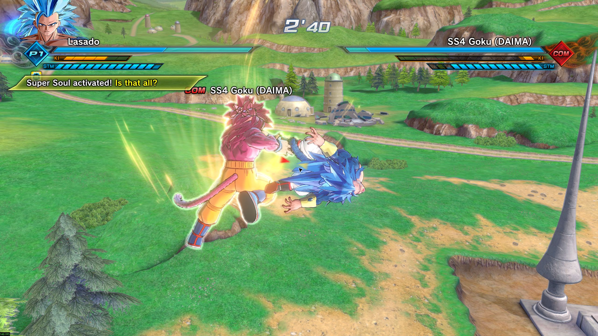
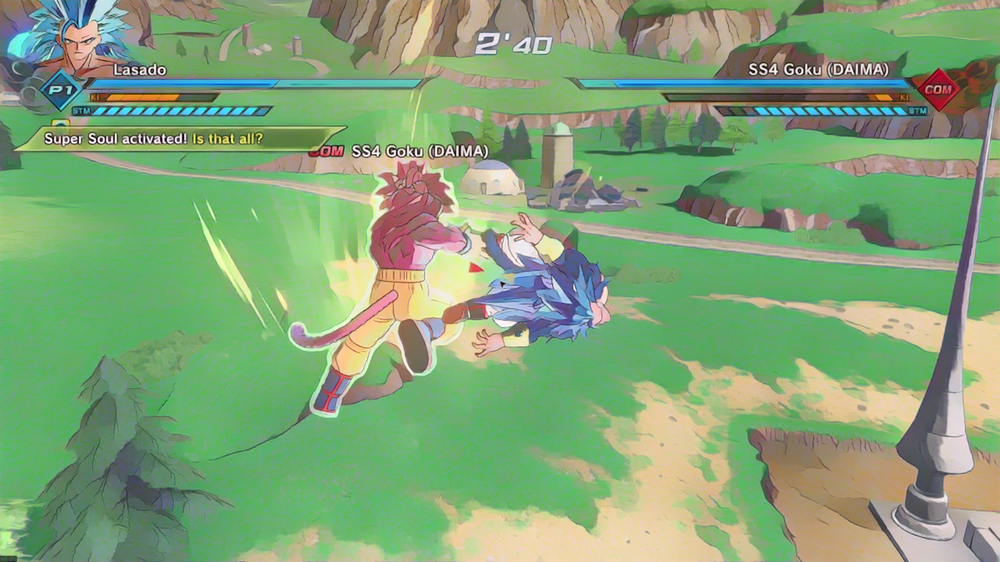
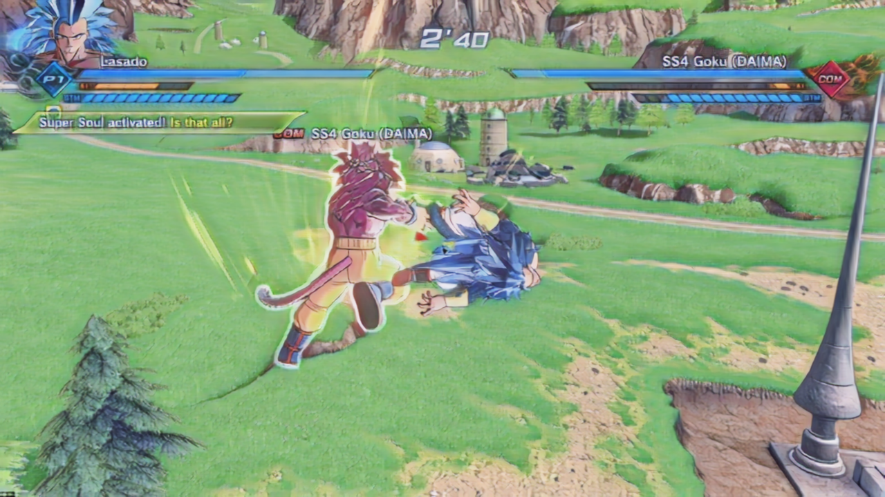

# Anime Neural ReShade

Native C++ neural cartoonization with two ways to use it: an **external window capture/viewer** and a **ReShade addon**. Both share the NVIDIA TensorRT backend and selectable **White-box Cartoonization** and **AnimeGANv2 Shinkai** profiles. Process below display resolution, then add hard cel shadows, outlines, and stronger colors.

The initial visual target is Dragon Ball Z: strong colors, flatter surfaces, sharp shadow boundaries, and readable characters and attacks. Dragon Ball Xenoverse 2 is the initial test game. This is an independent project.

| Mode | Where it runs | Intended use |
|---|---|---|
| Normal addon: `CelShade.addon64` | Inside ReShade in the game process | Games/launches that permit full ReShade addons; retains the full finishing controls and HUD masks. |
| External viewer: `anime_viewer.exe` | Separate process, Windows window capture | Visual processing without installing game DLLs, including testing alongside EAC. Capture compatibility must still be verified per game. |

Both modes are included and maintained together. The external mode is not a replacement `dxgi.dll` proxy.

**Development preview:** native binaries pass GPU, ReShade, and real Windows capture tests with both models. Live-game visual acceptance, sustained combat performance, manual overlay verification, and a 30-minute stability run remain pending. This is not yet a stable release.

[Download the development release](https://github.com/Alex2212/anime-neuralreshade/releases) · [Build](BUILDING.md) · [Benchmarks](BENCHMARKS.md) · [Compatibility](COMPATIBILITY.md)

## System requirements

**For the external viewer, keep the package outside the game folder. ReShade is not required.** Run `anime_viewer.exe`, select a capturable window and a profile, then Start. Neural processing requires the separate local setup below; finishing-only mode does not require NVIDIA libraries.

**Known addon blocker:** Xenoverse 2's Easy Anti-Cheat rejected the full-addon ReShade `dxgi.dll` as an **untrusted system file**. That installation was rolled back. The external viewer uses Windows Graphics Capture in its own process and puts no DLL into the game. It avoids that injection path, but protected content can still block capture. **Actual Xenoverse 2/EAC viewer compatibility has not yet been verified.** No EAC bypass is included.

| Component | Requirement and tested status |
|---|---|
| Operating system | Windows x64. Tested on Windows 11. Viewer APIs require Windows 10 2004 or later; Windows 10 is untested. |
| External viewer | Capturable, non-minimized SDR window, preferably windowed/borderless. Windows Graphics Capture must be available. Own D3D11 renderer; no game API hook. |
| Addon renderer | Direct3D 11, SDR RGBA8. Other APIs/HDR are bypassed. |
| ReShade (addon only) | **6.1.1 with full addon support**, API 12 and ImGui 1.90.4. Ordinary limited-addon builds cannot load it. Not needed for the viewer. |
| Neural GPU | NVIDIA GPU supported by CUDA 12.9 and TensorRT 10.13.3.9. **RTX 5090 is the only tested GPU.** Viewer selects an NVIDIA adapter; cross-adapter capture is unvalidated. Addon must use the game's adapter. AMD/Intel neural backends are not implemented. |
| Driver | CUDA 12.9-compatible NVIDIA driver. Tested: 621.14. |
| Runtime | TensorRT 10.13.3.9 (`nvinfer_10.dll`), CUDA runtime 12.9.79 (`cudart64_12.dll`), Microsoft Visual C++ x64 runtime. Download separately. |
| Models | Locally prepared engine **and its `.plan.ini` contract**, matching the GPU, TensorRT version, model, shape, and precision. Engines are not universally portable. |
| VRAM and RAM | Minimums are **not established**. Account for the game plus inference workspace, weights, textures, and tensors. A 5090 result is not a lower-end GPU guarantee. |
| First-time preparation | Python 3.11 for offline export/reference checks, Git, and the pinned SDK downloads. The game runtime itself uses C++ only. Allow several GB for SDKs and conversion dependencies. |

The viewer `.exe` and `.addon64` are x64. There is no supported 32-bit build or universal anti-cheat compatibility claim.

## First model comparison

The same Xenoverse 2 combat frame is shown below. These are **static model evaluations**, before the final DBZ finishing preset. Neural processing is 1280×720; output is resized to the 2560×1440 source display. README previews are downscaled. Motion stability is not established by these images.

| Original | White-box Cartoonization | AnimeGANv2 Shinkai |
|---|---|---|
|  |  |  |

White-box tends to simplify surfaces more strongly. AnimeGAN retains more of the original texture. Both are available as selectable profiles; neither is a Dragon Ball-specific trained model. The screenshots are included with the project owner's permission; game imagery remains the property of its respective rights holders.

## Features

- External Windows Graphics Capture viewer: model selection, live neural blend, fixed DBZ finishing, split comparison, F10 bypass, and optional F9 click-through overlay. No game installation or process manipulation.
- NVIDIA Image Scaling (NIS) in the viewer: edge-adaptive spatial scaling directly from the native model grid to capture resolution. A Processing quality dropdown lists installed resolutions for the selected model and precision. Capture/model/display dimensions and the active scaling path are shown separately.
- Extra outlines are off by default to avoid doubling Xenoverse 2's existing cel-shading lines. The viewer's optional **Extra outlines** checkbox restores the added edge pass. The addon FX default and supplied DBZ preset also start without added outlines; color and shadow settings are retained.
- Optional spatial edge anti-aliasing after styling, enabled by default. It reduces diagonal stair steps while preserving flat-region colors; it does not reconstruct missing detail or provide temporal AA.
- Three editable HUD preservation regions in the viewer. Original capture pixels replace the styled pixels inside enabled masks after finishing/AA. The normal addon retains its existing two HUD exclusion rectangles.
- Bounded two-frame capture pool, latest available frame processing capped at 60 FPS, GPU-only BGRA-to-RGBA conversion and compositing. No full-frame CPU transfer in normal viewer use.
- Overlay follows the selected window, leaves input with that window, and hides when the source loses focus, minimizes, stops producing frames for two seconds, closes, or capture fails. Manual overlay acceptance is pending.
- Native `.addon64` with a separately loaded NVIDIA backend. Missing or rejected neural dependencies keep the original image visible.
- Same-frame CUDA–D3D11 capture, preprocessing, TensorRT execution, and output. No full-frame CPU transfers in the live processing path.
- Background engine loading/warm-up; engine building is an explicit offline step.
- FP32 reference and mixed FP16 profiles with FP32 NHWC input/output. SHA-256, GPU UUID, shape, color order, and runtime validation.
- In-overlay model/profile selection and reload. Local prepared profiles appear from `cache/*.plan` plus `.plan.ini`.
- Independent neural composite, edge-preserving smoothing, two-tone, outlines, and color techniques.
- Hue-preserving two-tone or literal two-color mode, threshold/softness, light/shadow levels and tints.
- F10 bypass by default, rebindable Windows virtual-key code, split comparison, two normalized HUD exclusion rectangles, presets, and reset controls.
- Present FPS, processed FPS, frame correspondence, GPU stage timings, CPU callback duration, and tracked allocation size.

The full captured frame contains the HUD. Both modes have manual exclusion regions; automatic HUD detection and access to a separate UI render pass are not implemented. The external viewer receives the final composed window, so a mask also leaves the scenery behind that HUD region unstyled. GPU kernel timings exclude graphics copies, synchronization, FX, and presentation. Viewer frame-work timing includes CPU submission/synchronous GPU waits and the Present call; it excludes time waiting for capture and display scan-out. Capture timestamp delta is a signed clock comparison, **not input latency**; compositor timestamps may be ahead of the local clock.

## External viewer: install and use

1. Download and extract the preview ZIP into its own folder **outside the game directory**. No ReShade DLL needs to be installed or replaced.
2. For neural models, install Python 3.11 and Git, then run `powershell -ExecutionPolicy Bypass -File scripts/setup_neural.ps1 -Python <path-to-Python311.exe>` from that folder. This downloads large pinned dependencies and prepares both model engines for your GPU. Review [third-party terms](THIRD_PARTY_NOTICES.md); the model projects have noncommercial restrictions. See [BUILDING.md](BUILDING.md#prepare-models-and-engines).
3. Start the game normally in SDR windowed/borderless mode. Launch `anime_viewer.exe`, select the game window and a prepared profile, and click **Start**. **Finishing only** can be used without model setup.
4. The styled output opens in a separate window. Choose **Click-through overlay**, then focus the game, to place output over it. F9 returns to the separate viewer; F10 toggles bypass. If another app owns either shortcut, use the visible controls. The viewer does not synthesize or forward game input.
5. Adjust **Neural blend**, **DBZ finishing**, or **Split comparison**. To change models, select a profile and click Start again. Stop ends capture. Closing the viewer controls exits the application.
6. Keep **Smooth jagged edges** enabled to soften diagonal aliasing after the style pass. Toggle it for a direct comparison; the shading and palette parameters are unchanged.
7. Enable **Preserve HUD regions** to keep the top HUD original. For training stats or the input panel, enable those rows and click **Apply HUD regions**. Edit Left/Top/Right/Bottom as percentages of the captured window (0-100). The defaults are starting points for Xenoverse 2; adjust them for your layout. Floating names, subtitles, menus and moving UI are not detected automatically.
8. Keep **NVIDIA upscale (NIS)** enabled. Choose **Processing quality**, then Start to load that resolution. It lists only locally prepared profiles for the same model and precision: 720p Performance, 1080p Quality, and 1440p High detail when available. These are model-resolution choices, not DLSS modes. At a 1440p capture size, 1080p uses NIS and 1440p uses an exact native copy. Maximize or overlay the viewer to avoid an additional small-window display resize.

If capture is blocked, the app cannot make that content available. A minimized source can stop supplying frames; restore it. Exclusive fullscreen, HDR, manual overlay behavior and EAC-protected Xenoverse combat remain unverified. The viewer has no recording, network upload, or telemetry feature. Its output can be captured by recording tools.

`anime_viewer.exe --demo` opens an animated built-in source for trying controls without a game. The repeatable capture self-test is documented in [BUILDING.md](BUILDING.md#validation).

## ReShade addon: install and use

Use this path only where full addons are permitted. It is blocked by the tested Xenoverse 2 EAC launch.

1. Download the preview ZIP from Releases. Keep its addon, backend, kernels, and FX from the same version. The standalone `.addon64` asset alone is only sufficient for the finishing-layer path.
2. Install ReShade **6.1.1 full addon support** for the game's Direct3D 11 renderer. Keep a backup of an existing ReShade installation. The project does not ship ReShade or alter the game's assets.
3. Extract the addon ZIP to a separate working folder. Prepare the NVIDIA runtime and local model engines using [BUILDING.md](BUILDING.md#prepare-models-and-engines) / `scripts/setup_neural.ps1` before enabling neural inference. This can take several minutes and downloads large SDKs. Review [third-party terms](THIRD_PARTY_NOTICES.md).
4. With the game closed, copy `CelShade.addon64`, `cel_nvidia.dll`, `kernels.ptx`, `CelShade.fx`, the runtime DLLs, and the `cache` folder beside the game's ReShade DLL. Preserve the `.plan.ini` files. Copy the supplied DBZ preset under a distinct name; do not overwrite your existing preset.
5. Add the directory containing `CelShade.fx` to ReShade's effect search paths if needed. Open ReShade and select the supplied DBZ preset, or enable the five `Cel_` techniques in their numbered order.
6. Open the **CelShade** overlay tab, choose a prepared model/resolution/precision profile, and wait for preparation. Configure finishing effects on ReShade's Home tab. F10 toggles the addon.

Default mode is **finishing layers only** until a model is explicitly selected. This makes the minimal addon useful without loading a missing NVIDIA dependency. Selecting neural mode without a valid engine produces original-frame bypass and a diagnostic.

To remove: close the game, remove only the files/folders you installed for this addon, and remove the `Cel_` techniques from your preset. Do not delete unrelated ReShade effects, DLLs, or presets. See [COMPATIBILITY.md](COMPATIBILITY.md) for troubleshooting.

## NVIDIA optimization and upscaling

The optimized path uses TensorRT mixed FP16 and fixed shapes, with processing resolution independent of display resolution. The external viewer now receives an additional texture at the actual model resolution and runs **NVIDIA Image Scaling (NIS)** directly on that grid, before finishing, edge AA and original HUD restoration. NIS performs edge-adaptive spatial reconstruction for supported 1x-2x scaling; it is not AI super-resolution and cannot recover all detail removed by the style model. The native-size path copies exactly. Unsupported ratios and NIS-off use an explicitly labelled bilinear fallback. The normal ReShade addon retains its existing CUDA bilinear output path and ABI. No temporal history is blended. See the [NIS SDK](https://github.com/NVIDIAGameWorks/NVIDIAImageScaling).

If a 1440p capture looks soft with a 1080p model, prepare a **native 2560x1440 White-box profile** with `scripts/setup_neural.ps1 -Height 1440 -Model whitebox`, then Refresh and select it. The capture resolution and model resolution are separate; a 1440p capture does not make a 1080p model operate at native detail. Native inference removes this rescaling step, but the model still intentionally simplifies textures. Compare with DBZ finishing disabled to isolate the model from the outline/shadow effect. Higher resolution needs additional GPU time.

**DLSS Super Resolution and DLSS Frame Generation are not implemented.** They require additional engine inputs and integration, including verified depth/motion data and, for FG, HUD-less color and presentation coordination. A finished-frame ReShade capture does not supply all of that. The project does not label spatial upscaling as DLSS or repeated model frames as 60 FPS. See the [NVIDIA DLSS guide](https://github.com/NVIDIA-RTX/Streamline/blob/main/docs/ProgrammingGuideDLSS.md) and [FG guide](https://github.com/NVIDIA-RTX/Streamline/blob/main/docs/ProgrammingGuideDLSS_G.md).

## Source layout

`src/viewer` contains the external capture application; `src/addon` contains ReShade integration and UI; `src/interop` owns D3D11 capture resources; `src/inference` contains the shared NVIDIA backend and CUDA kernels. `shaders` contains original FX passes, `scripts` handles offline setup/build/evaluation, `models` records model contracts, and `tests` contains real GPU and ReShade harnesses.

Weights, generated TensorRT engines, NVIDIA SDKs, recordings, and local evaluation data are excluded from Git. Release assets contain original compiled code, PTX, shaders, presets, setup scripts, and documentation; they do not include model weights or NVIDIA runtime binaries.
